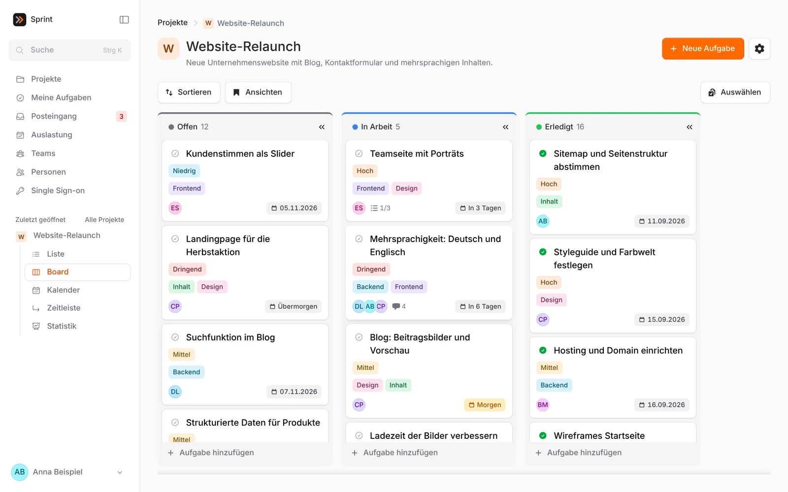
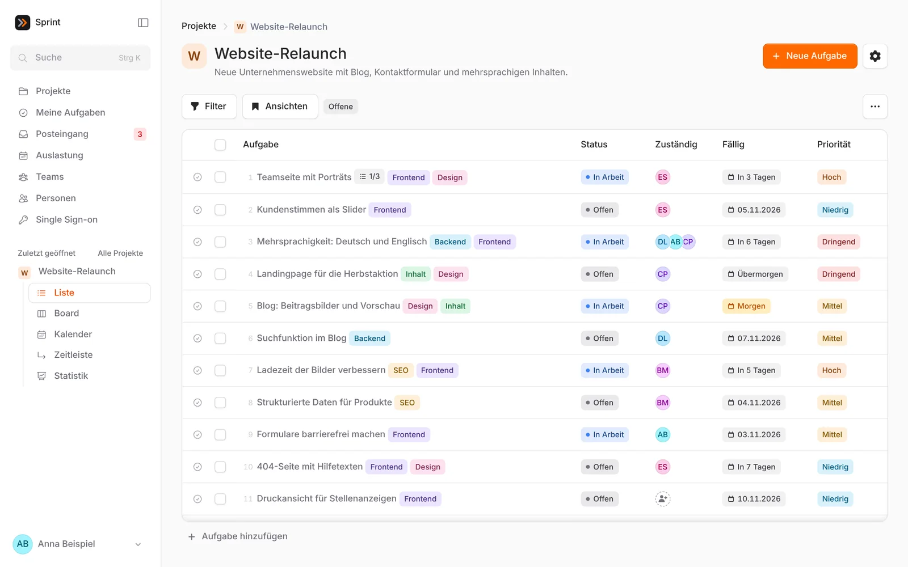
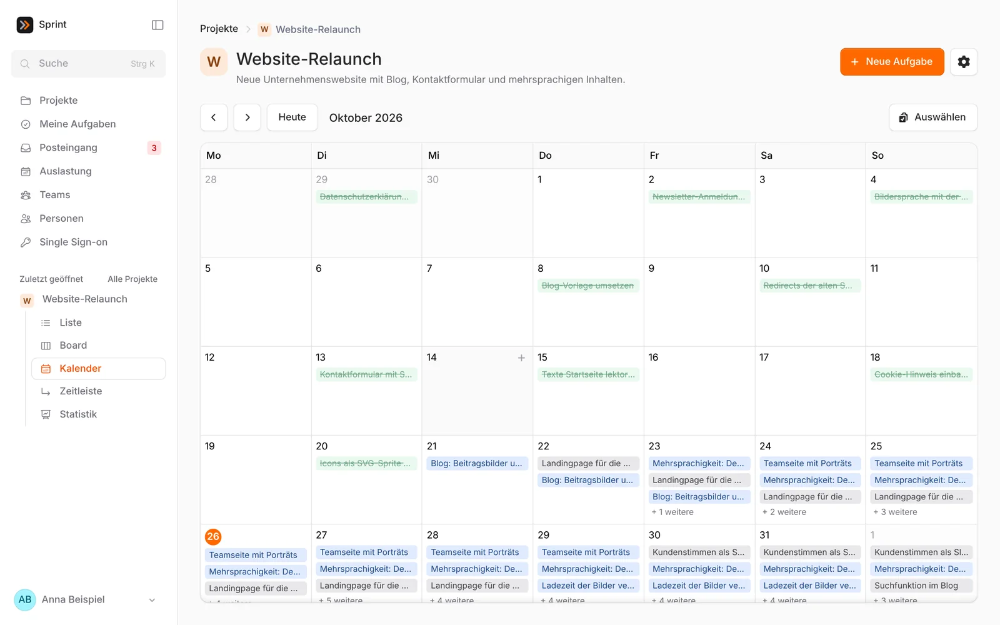
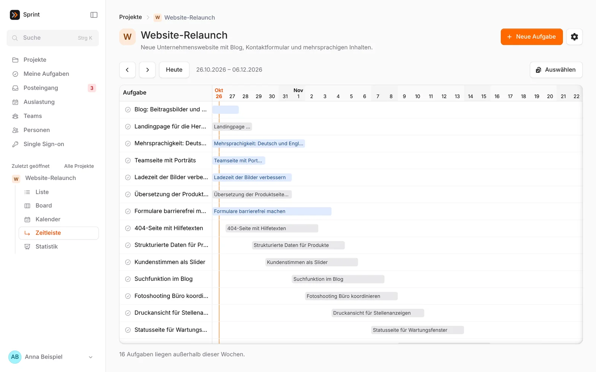
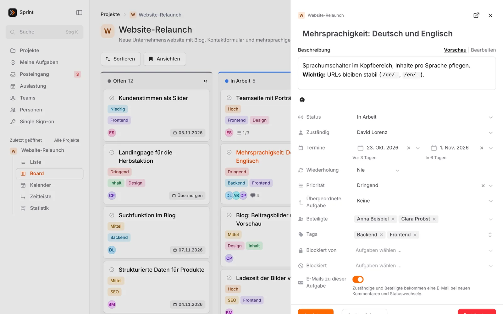
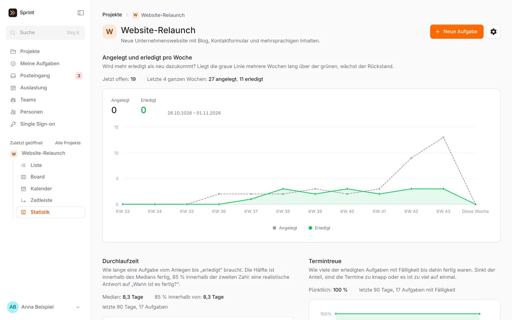
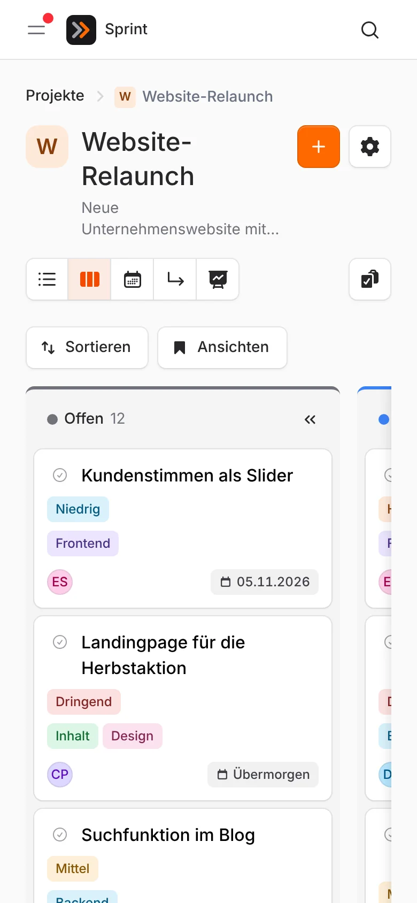

# Sprint

Sprint ist eine schlanke Aufgabenverwaltung für Teams: Projekte, Aufgaben und Unteraufgaben, Liste, Kanban-Board, Kalender, Zeitleiste und Statistik, Auslastung pro Person und Woche, Kommentare mit Markdown und `@`-Erwähnungen, Benachrichtigungen per Mail, im Posteingang und als Push auf Browser und Handy, ein MCP-Server für KI-Agenten. Die Oberfläche gibt es auf Deutsch und Englisch, hell und dunkel.

<picture>
  <source media="(prefers-color-scheme: dark)" srcset="docs/screenshots/board-dark.webp">
  
</picture>

*Alle Screenshots zeigen erfundene Beispieldaten.*

Gebaut mit Laravel 13, Livewire 4 und [Flux UI Pro](https://fluxui.dev) (kommerzielle Lizenz nötig).

## Was Sprint kann

**Eine Aufgabe, viele Ansichten.** Dieselben Aufgaben als Liste, Board, Kalender und Zeitleiste. Sortierungen und Filter lassen sich als Ansicht speichern, privat oder für das ganze Projekt, und eine davon gilt beim Öffnen als Standard. Termine ändert man per Ziehen, viele Aufgaben auf einmal per Mehrfachauswahl.

<picture>
  <source media="(prefers-color-scheme: dark)" srcset="docs/screenshots/list-dark.webp">
  
</picture>

<picture>
  <source media="(prefers-color-scheme: dark)" srcset="docs/screenshots/calendar-dark.webp">
  
</picture>

<picture>
  <source media="(prefers-color-scheme: dark)" srcset="docs/screenshots/timeline-dark.webp">
  
</picture>

**Alles an einer Aufgabe.** Beschreibung in Markdown, Unteraufgaben in beliebiger Tiefe, eigene Felder und Status pro Projekt, Tags, Abhängigkeiten, Anhänge, Wiederholungen, Kommentare mit `@`-Erwähnungen und Reactions sowie ein Verlauf. Die Aufgabe öffnet als Seitenleiste neben der Liste oder dem Board.

<picture>
  <source media="(prefers-color-scheme: dark)" srcset="docs/screenshots/task-dark.webp">
  
</picture>

**Den Überblick behalten.** Die Statistik zeigt, ob mehr erledigt wird als neu dazukommt, wie lange Aufgaben brauchen und wie pünktlich sie fertig werden. Die Auslastung zeigt pro Person und Woche, was fällig ist, samt geplanter Abwesenheit.

<picture>
  <source media="(prefers-color-scheme: dark)" srcset="docs/screenshots/statistics-dark.webp">
  
</picture>

**Auch unterwegs.** Sprint lässt sich als App auf dem Handy installieren, bringt Push-Benachrichtigungen mit und zeigt eine Hinweisseite, wenn der Server nicht erreichbar ist.



Weitere Funktionen:

- Rollen pro Projekt (Ansehen, Bearbeiten, Verwalten) und Teams als Gruppen
- Automatisierungen pro Projekt (Auslöser, Bedingung, Aktion)
- Anmeldung mit Passwort, Passkeys und Zwei-Faktor-Code, auf Wunsch mit Google (Registrierung nur für erlaubte Domains)
- Befehlspalette, globale Suche und Tastenkürzel
- Tageszusammenfassung und Erinnerung am Vortag per E-Mail, „Bitte nicht stören“
- Live-Updates über Reverb (optional)
- CSV-Export und -Import, Import aus Asana
- MCP-Server, damit KI-Agenten Aufgaben lesen und anlegen können

Die vollständige Liste steht in [Funktionen](docs/features.md).

## Schnellstart

```bash
git clone https://github.com/smares/sprint.git
cd sprint
composer setup
php artisan user:create "Anna Beispiel" anna@example.com --admin
composer dev
```

Vorher die Zugangsdaten für `livewire/flux-pro` hinterlegen, siehe [Installation](docs/installation.md).

## Dokumentation

Alles Weitere steht in [`docs/`](docs/README.md):

- [Funktionen](docs/features.md)
- [Installation](docs/installation.md)
- [Bereitstellung](docs/deployment.md) (Laravel Forge, Laravel Cloud, Docker Compose, Traefik, Dokploy)
- [Umzug von Asana](docs/asana-import.md)
- [Konfiguration](docs/configuration.md) (unter anderem die Anmeldung mit Google)
- [Wartung](docs/maintenance.md) (Updates, Gesundheitsprüfung, Backup)
- [Entwicklung](docs/development.md)

## Lizenz

Sprint steht unter der [Apache License 2.0 mit Commons Clause](LICENSE): Sie dürfen es nutzen, auch in der eigenen Firma selbst hosten, verändern und (auch öffentlich) weitergeben, solange nicht gegen Entgelt. Nicht erlaubt ist, es zu „verkaufen“: Dritten gegen Entgelt (auch für Hosting, Beratung oder Support) ein Produkt oder einen Dienst anzubieten, dessen Wert im Wesentlichen aus Sprint kommt. Maßgeblich ist der Lizenztext. Flux UI Pro ist ein kommerzielles Produkt und braucht eine eigene Lizenz (je Lizenz eine Produktivumgebung); wer Sprint betreibt, braucht also eine eigene Flux-Pro-Lizenz.
